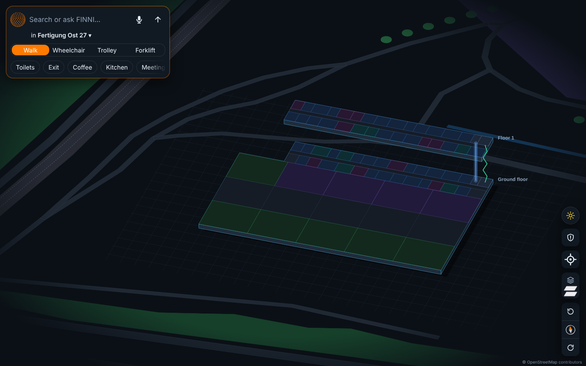
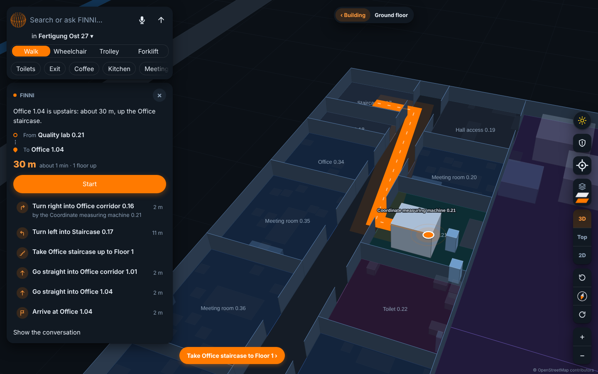
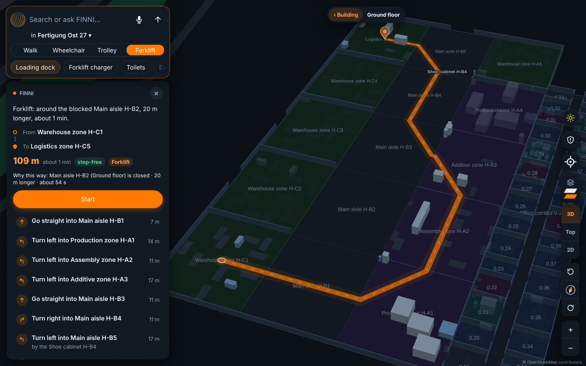
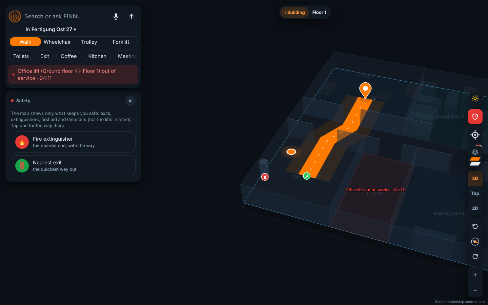

# FINNI: Google Maps for every building

FINNI knows a building as well as its facility manager does. Ask it by voice or text where something is,
and it finds you, finds the thing and walks you there, on a 3D map of the building. It works for people on
foot, in a wheelchair, pushing a trolley or driving a forklift, and it keeps up when something breaks.

Built for the Industrial Agents Hackathon 2026, Track 01 ("Google Maps for every building"). The organisers'
brief is in [CHALLENGE.md](CHALLENGE.md).



## The idea in one line

**Claude understands the person; a deterministic engine supplies every fact.** The model never guesses a
distance, an area or a count: it calls tools, and the engine computes the answer from the building's data.

## What you can do

| | |
|---|---|
| **Ask anything** | "Where's the coffee machine?", "How do I get to office 1.04 without stairs?", "How many printers are on floor 2?" Typed, spoken (ElevenLabs) or one tap on a quick search made from what the building has. |
| **Be found without GPS** | FINNI asks at most one question, "What can you see near you?", with real landmarks as options (a machine, the lift, an entrance). Or tap the map: "I'm here". |
| **Directions people can follow** | Turns and things you'll see ("turn right into the main aisle, by the shoe cabinet"), the metres and minutes, and **Start** to walk it step by step, up the stairs to the next floor. |
| **See the building** | Every floor as a slab in a stack you can turn, tilt and fly into; 3D, bird's eye or flat 2D; stairs and lifts drawn between the floors; the things along your route stay bright. Dark and light look. |
| **"The lift is broken"** | One sentence reports it for everyone: every colleague's routes avoid it, it turns red on every map, and the maintenance team gets a message (inbox, and email when set up). "It works again" clears it. |
| **Safety mode** | The shield dims the map to exits, fire extinguishers, defibrillators and stairs. Nearest exit or extinguisher: one tap, instantly, no AI call. |
| **How you move** | Walk · Wheelchair · Trolley · Forklift. Each changes which doors fit, whether steps are allowed and, for a forklift, which spaces it may drive through. The route card says why it goes round: "Main aisle H-B2 is closed · 20 m longer · about 54 s". |
| **Facility manager** | Close a lift or room, add a door, move a machine, block an aisle: the map and every route follow at once. |
| **Build from floor plans** | Give it only the SVG floor plans: it reads the rooms, doors and labels, lines the floors up and finds the stairs, even in plans that don't draw any, then asks the person what the drawings can't say. |

| A route with its steps | A forklift around a blocked aisle | Safety mode, a lift reported broken |
|---|---|---|
|  |  |  |

## How it works

```
 website (Expo, react-native-web)        FastAPI server (server/)                  engine (navcore/)
 ┌───────────────────────────┐   HTTP   ┌──────────────────────────────┐  calls  ┌──────────────────────────┐
 │ search bar + mic          │────────▶│ one Claude agent per         │───────▶│ building.json → graph     │
 │ 3D / top / 2D map, route  │◀────────│ conversation (navagent/)     │◀───────│ shortest paths, areas,    │
 │ profile chip, safety      │  reply,  │ reports, safety, voice,      │  JSON   │ walls, reachability,      │
 └───────────────────────────┘  map    │ plan imports                 │         │ profiles, floor plans     │
                                        └──────────────────────────────┘         └──────────────────────────┘
```

- **The engine** (`navcore/`) loads a building and builds a graph of rooms, doors, corridors, stairs and lifts,
  with real walking paths inside each room (15 cm off the walls) and a shortest-path search. Stairs cost by the
  height climbed, a lift ride a fixed amount plus its height, exactly as the judges' route model. It also
  answers areas, shared walls, rooms above and below, reachability, errands and "what if we add a door".
  Profiles (`navcore/profiles.py`) only change the graph: door width, no steps, the spaces a forklift may cross.
  `navcore/plans.py` turns SVG floor plans into the same `building.json`.
- **The agent** (`navagent/`) is Claude with 18 to 30 tools over the engine (by mode). In a conversation it asks only what
  changes the answer, remembers what it was told, and shows the result on the map. In benchmark mode it never
  asks, and code (not the model) writes the answer lines from its final tool call. In builder mode it sets up a
  building from plans by conversation.
- **The server** (`server/`) keeps the conversations, the reports everyone shares, the maintenance inbox, the
  safety quick buttons and the voice (ElevenLabs speech in and out; keys stay on the server), and serves the
  website on the same address.
- **The website** (`app/`) is an Expo app built for the web: the map is drawn in SVG (no 3D engine), with
  OpenStreetMap context around the building.

More in [ARCHITECTURE.md](ARCHITECTURE.md) and, for finding people and things, [LOCATING.md](LOCATING.md).

## Results

All runs are in [SUBMISSION/BENCHMARK.md](SUBMISSION/BENCHMARK.md), on the organisers' kit 1.1.0 rules.

| Check | Result |
|---|---|
| Development buildings (benchmark, warm-up, reworded and novel questions) | 114 / 114 |
| **Hold-out buildings, locked away and run once, nothing tuned on them** | **35 / 36** |
| Test set submission | 145 answers, every question run twice (both runs agreed on all 145) |
| Buildings rebuilt from floor plans only (hold-out) | rooms 100%, doors 97%, routes 82% |
| An unseen building | one command, about 6 s per question |

## Run it

You need [uv](https://docs.astral.sh/uv/) and Node.js, and an Anthropic API key (ElevenLabs is optional, for
the voice).

```bash
uv sync
cp .env.example .env             # then put ANTHROPIC_API_KEY (and ELEVENLABS_API_KEY) in it
cd app && npm install && npm run build && cd ..
uv run --env-file .env uvicorn server.app:app --port 8000
```

Open http://localhost:8000. To share it with phones over a public HTTPS link (the mic needs HTTPS):
`scripts/share.sh`. The demo, step by step: [DEMO.md](DEMO.md).

**Answer a set of questions** (the scored run, any building in the kit's format, or one with only floor plans):

```bash
uv run --env-file .env python -m navagent.benchmark <building or questions> --out answers.csv
```

**Chat with a building in the terminal:** `uv run --env-file .env python -m navagent data/dev/proc-factory-dev-003`

**Tests:** `uv run pytest` (offline and free: the engine, the tools, the server, every dataset answer, unseen
buildings, profiles, reports); `uv run pytest --holdout` for the locked buildings; `--live` for the paid
conversation tests. Website: `cd app && npx jest`, and `node e2e/run.cjs` for the end-to-end check on a phone
and a laptop.

## What's where

| Path | What |
|---|---|
| `navcore/` | The engine: route graph and geometry (`engine.py`), names to ids (`resolve.py`), floor plans (`plans.py`), profiles (`profiles.py`) |
| `navagent/` | The Claude agent, its tools, the plan builder and the one-command benchmark run |
| `server/` | FastAPI backend: conversations, reports and maintenance, safety, plan imports |
| `voice/` | Speech in and out with ElevenLabs |
| `app/` | The website (Expo, react-native-web) and its tests |
| `evals/` | Our checks: reworded and novel questions, floor-plan rebuilds, submission checks |
| `holdout/` | The locked hold-out split |
| `tests/` | pytest |
| `SUBMISSION/` | What is graded: `answers.json` (our 145 test answers) and `BENCHMARK.md` (how they were made, all runs) |
| `results/` | The same answers as the benchmark run wrote them (`team_answers.csv`) |
| `data/`, `benchmark/`, `starter_agent/` | The organisers' kit (data, scorer, starter agent), unchanged |

Docs: [ARCHITECTURE.md](ARCHITECTURE.md) · [BENCHMARK.md](SUBMISSION/BENCHMARK.md) · [LOCATING.md](LOCATING.md) ·
[DEMO.md](DEMO.md) · [VIDEO.md](VIDEO.md) · [app/README.md](app/README.md) · [CHALLENGE.md](CHALLENGE.md)

## Team

Daksh Verma and Jivithesh Anagani. Built with Claude (Anthropic) and ElevenLabs. Map context © OpenStreetMap
contributors (ODbL); data and licences in [ATTRIBUTION.md](ATTRIBUTION.md) and [CHALLENGE.md](CHALLENGE.md).
